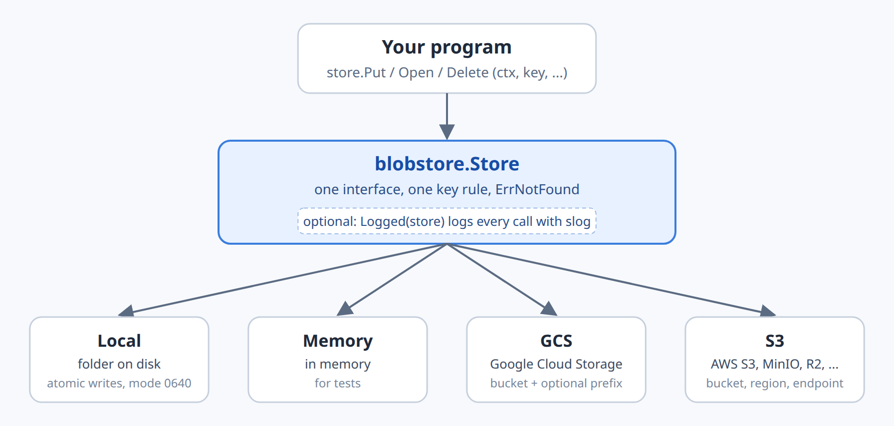
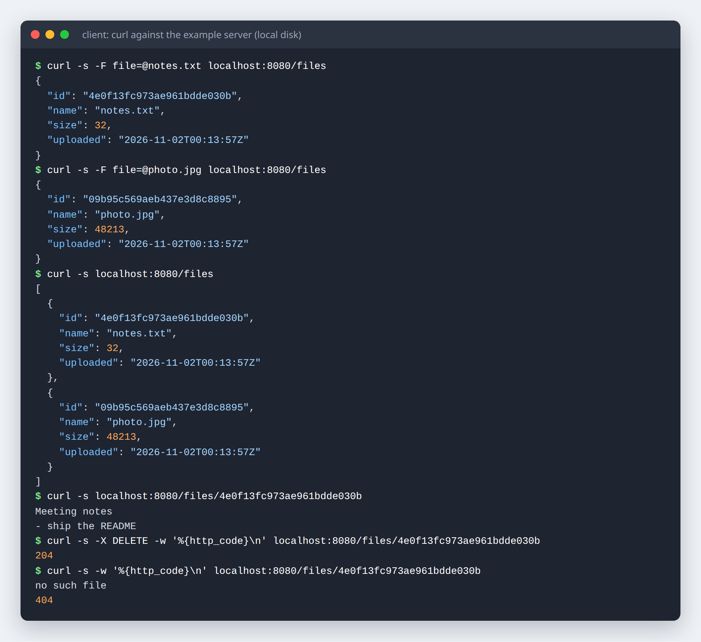
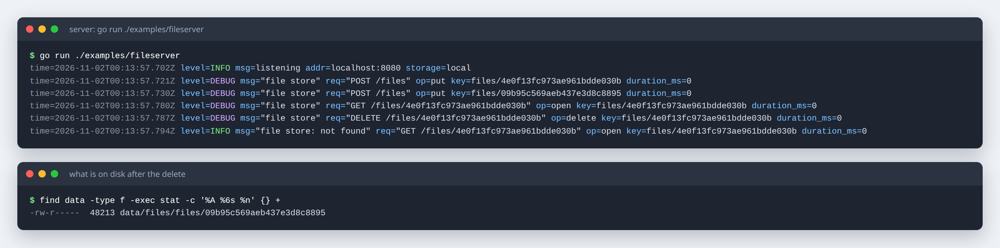
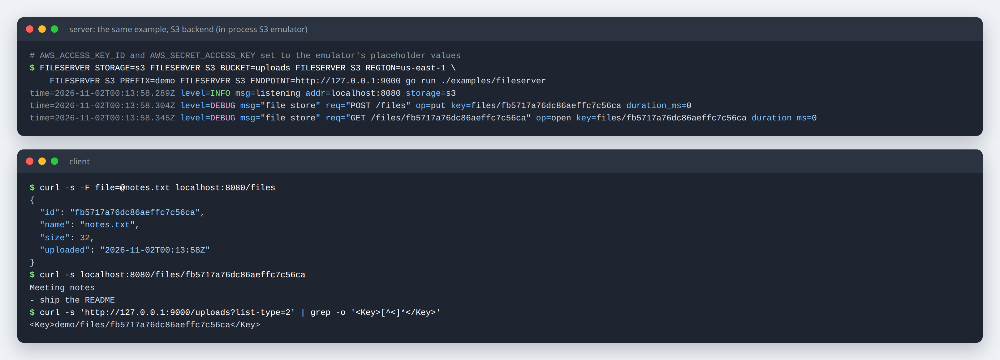
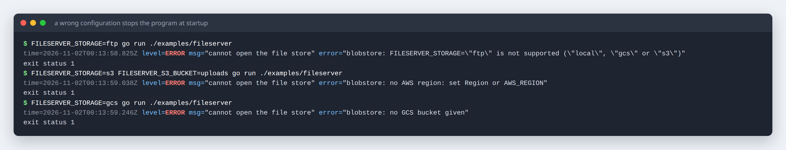

# blobstore

[](https://pkg.go.dev/github.com/ez-technologies/blobstore)
[](LICENSE)

**Pluggable file storage for Go.** Your program stores and reads files under
opaque keys through one three-method interface; whether the bytes end up in a
folder on disk, in memory, in Google Cloud Storage or in S3 (or MinIO, R2 and
other S3-compatible stores) is a deployment setting, not a code change.

```go
type Store interface {
	Put(ctx context.Context, key string, r io.Reader) error
	Open(ctx context.Context, key string) (io.ReadCloser, error) // ErrNotFound if missing
	Delete(ctx context.Context, key string) error                // missing is not an error
}
```



## Contents

- [Why one interface](#why-one-interface)
- [Install](#install)
- [Quick start](#quick-start)
- [Screenshots](#screenshots)
- [How to](#how-to)
  - [Store files on local disk](#store-files-on-local-disk)
  - [Use memory in tests](#use-memory-in-tests)
  - [Use Google Cloud Storage](#use-google-cloud-storage)
  - [Use S3 and S3-compatible stores (MinIO, R2)](#use-s3-and-s3-compatible-stores-minio-r2)
  - [Choose the backend from environment variables](#choose-the-backend-from-environment-variables)
  - [Log every operation](#log-every-operation)
  - [Write your own backend](#write-your-own-backend)
- [Configuration](#configuration)
- [Keys](#keys)
- [Tests](#tests)
- [Licence](#licence)

## Why one interface

Most programs need very little from file storage: put these bytes under this
name, give them back, forget them. Writing that against a cloud SDK ties the
whole program to one provider and makes every test need a bucket or a mock.

With `blobstore` the program depends on `Store` only:

- **Develop on a laptop** with a folder on disk, **run tests** in memory, and
  **deploy** to a bucket, with the same code.
- **Move providers** by changing environment variables.
- **The same rules everywhere**: every backend accepts and refuses the same
  keys, a missing file is always `ErrNotFound`, deleting a missing file is
  never an error, and putting a key again replaces the file.
- **Fail at startup, not at the first upload**: the cloud backends check that
  the bucket can be reached when they are created, and `FromEnv` refuses an
  unknown or incomplete configuration instead of quietly falling back to disk.
- **Streaming**: `Put` takes an `io.Reader` and `Open` returns an
  `io.ReadCloser`, so large files are not held in memory (except by `Memory`).

## Install

```sh
go get github.com/ez-technologies/blobstore
```

Requires the Go version named in [`go.mod`](go.mod).

## Quick start

```go
package main

import (
	"context"
	"fmt"
	"io"
	"log"
	"strings"

	"github.com/ez-technologies/blobstore"
)

func main() {
	ctx := context.Background()

	store, err := blobstore.NewLocal("./data/files")
	if err != nil {
		log.Fatal(err)
	}

	if err := store.Put(ctx, "reports/2026/summary.txt", strings.NewReader("hello")); err != nil {
		log.Fatal(err)
	}

	rc, err := store.Open(ctx, "reports/2026/summary.txt")
	if err != nil {
		log.Fatal(err)
	}
	defer rc.Close()
	data, _ := io.ReadAll(rc)
	fmt.Println(string(data)) // hello

	_ = store.Delete(ctx, "reports/2026/summary.txt")
}
```

A complete program is in [`examples/fileserver`](examples/fileserver/main.go):
a small HTTP file server that stores each upload under an opaque key
(`files/<random id>`, never the name the client sent), lists, downloads and
deletes files, picks its backend from `FILESERVER_*` environment variables and
logs every store operation with `log/slog`.

```sh
go run ./examples/fileserver          # local disk, ./data/files, on localhost:8080

curl -F file=@notes.txt localhost:8080/files     # upload
curl localhost:8080/files                        # list
curl localhost:8080/files/<id>                   # download
curl -X DELETE localhost:8080/files/<id>         # delete
```

`FILESERVER_ADDR` changes the listening address. The example keeps its list of
uploads in memory to stay short; a real program keeps that index (id, original
name, size, owner) in its database and only the contents in the store.

## Screenshots

All of these are real runs of `examples/fileserver`.

**Upload, list, download and delete against the local-disk backend.** Each
upload gets a random id; the original file name is kept as metadata only.
After the delete, the same download answers `404`.



**The server's log for the same session, and what is on disk.** `Logged`
writes one line per store call with the operation, the key and the duration;
the request each call belongs to comes from the context logger
(`LogOptions.FromContext`). Successful calls are `DEBUG`, a missing file is
`INFO`, and contents are never logged. On disk only the photo is left, stored
under its opaque key with mode `0640`.



**The same program on the S3 backend**, pointed at an in-process S3 emulator
(the one the tests use) with `FILESERVER_S3_ENDPOINT`. Nothing in the code
changed. The object lands in the bucket under the configured prefix:
`demo/files/<id>`.



**A wrong configuration stops the program at startup** with a message that
says what is missing, instead of failing on the first upload.



## How to

### Store files on local disk

```go
store, err := blobstore.NewLocal("/var/lib/myapp/files") // created if missing
```

- Keys become paths under the folder: `a/b/c.pdf` is `<dir>/a/b/c.pdf`.
- Writes are atomic: the file is written beside the target and renamed, so a
  reader never sees half a file, and a failed write leaves nothing behind.
- Files are created with mode `0640` and folders with `0750`, so other users
  get no access.
- A key can never point outside the folder.

Good for a laptop and for one server with a persistent disk. Several servers
sharing files need an object store.

### Use memory in tests

```go
func TestUpload(t *testing.T) {
	store := blobstore.NewMemory()
	h := NewHandler(store) // your code takes a blobstore.Store

	// ... exercise h ...

	assert.Equal(t, []string{"files/abc"}, store.Keys())
}
```

`Memory` is safe for concurrent use, refuses the same keys on `Put` as the
other backends, and has `Keys()` to see what was stored. It keeps whole files
in memory, so it is for tests only.

### Use Google Cloud Storage

```go
store, err := blobstore.NewGCS(ctx, blobstore.GCSOptions{
	Bucket: "my-bucket",
	Prefix: "files", // optional: every key goes under files/
})
```

- Credentials come from
  [Application Default Credentials](https://cloud.google.com/docs/authentication/application-default-credentials):
  the service account of the machine or service you run on, or
  `gcloud auth application-default login` on a laptop. The account needs to
  read the bucket's metadata and to create, read and delete objects in it.
- `NewGCS` reads the bucket's attributes before returning, so a wrong bucket
  name or a missing permission is an error at startup.
- `Prefix` lets several programs or environments share one bucket.
- `GCSOptions.ClientOptions` passes extra
  [`option.ClientOption`](https://pkg.go.dev/google.golang.org/api/option)s to
  the client; leave it empty in production.

### Use S3 and S3-compatible stores (MinIO, R2)

AWS S3:

```go
store, err := blobstore.NewS3(ctx, blobstore.S3Options{
	Bucket: "my-bucket",
	Region: "eu-west-1", // optional: else AWS_REGION / AWS_DEFAULT_REGION
	Prefix: "files",     // optional
})
```

An S3-compatible server is the same with `Endpoint` set; path-style addressing
is turned on whenever an endpoint is given:

```go
// MinIO
store, err := blobstore.NewS3(ctx, blobstore.S3Options{
	Bucket:   "my-bucket",
	Region:   "us-east-1",
	Endpoint: "http://localhost:9000",
})

// Cloudflare R2
store, err := blobstore.NewS3(ctx, blobstore.S3Options{
	Bucket:   "my-bucket",
	Region:   "auto",
	Endpoint: "https://<account-id>.r2.cloudflarestorage.com",
})
```

- Credentials come from the default AWS chain: the `AWS_ACCESS_KEY_ID` and
  `AWS_SECRET_ACCESS_KEY` environment variables, `AWS_PROFILE` and the shared
  config files, or an instance or task role. For MinIO and R2, put the access
  key pair that service gives you in the same variables. They are never passed
  in code.
- A region is required (`Region`, or `AWS_REGION`); without one `NewS3` fails.
- `NewS3` calls `HeadBucket` before returning, so a wrong bucket, endpoint or
  permission is an error at startup.
- `Put` streams through the S3 upload manager, so a reader of unknown length
  works and big files are sent in parts.

### Choose the backend from environment variables

```go
store, err := blobstore.FromEnv("MYAPP_")
```

`FromEnv` reads variables that all start with the prefix you give (it may be
`""`), so the names never collide with your other settings:

```sh
# local disk (also the default when MYAPP_STORAGE is empty)
MYAPP_STORAGE=local MYAPP_STORAGE_DIR=/var/lib/myapp/files ./myapp

# Google Cloud Storage
MYAPP_STORAGE=gcs MYAPP_GCS_BUCKET=my-bucket MYAPP_GCS_PREFIX=files ./myapp

# S3, or an S3-compatible store
MYAPP_STORAGE=s3 MYAPP_S3_BUCKET=my-bucket MYAPP_S3_REGION=eu-west-1 ./myapp
MYAPP_STORAGE=s3 MYAPP_S3_BUCKET=my-bucket MYAPP_S3_REGION=us-east-1 \
  MYAPP_S3_ENDPOINT=http://localhost:9000 ./myapp
```

Any other value of `MYAPP_STORAGE` is an error, and so is a cloud backend that
cannot be built. See [Configuration](#configuration) for every variable.

### Log every operation

```go
store = blobstore.Logged(store, blobstore.LogOptions{
	Logger:  slog.Default(), // nil means slog.Default()
	Message: "file store",   // the default
})
```

`Logged` wraps any `Store` and writes one line per call with `op`
(`put`, `open`, `delete`), `key` and `duration_ms`:

| Result | Level | Message |
|---|---|---|
| success | `Debug` | `file store` |
| `ErrNotFound` | `Info` | `file store: not found` |
| any other error | `Error` | `file store failed`, plus `error` |

File contents are never logged. Success is logged at `Debug`, so set your
handler's level to `slog.LevelDebug` to see every call (the example does).

To tie each line to the request that caused it, give a function that returns
the request's logger from the context; when it returns nil, `Logger` is used:

```go
store = blobstore.Logged(store, blobstore.LogOptions{
	Logger: base,
	FromContext: func(ctx context.Context) *slog.Logger {
		lg, _ := ctx.Value(loggerKey{}).(*slog.Logger) // set by your HTTP middleware
		return lg
	},
})
```

### Write your own backend

Any type with the three methods is a `Store`, and works with `Logged` and
everything else that takes one. Keep the contract the built-in backends keep:

- `Put` replaces any existing file under the key.
- `Open` returns `blobstore.ErrNotFound` (or an error wrapping it) when there is
  no file, so callers can use `errors.Is`.
- `Delete` of a missing key returns nil.
- Refuse keys that are empty, contain `..`, start with `/` or contain anything
  but letters, digits and `/ - _ .`.

A store can also wrap another one, as `Logged` does:

```go
// Prefixed puts every key of another store under a fixed folder.
type Prefixed struct {
	Inner  blobstore.Store
	Folder string // for example "tenant-a/"
}

func (p Prefixed) Put(ctx context.Context, key string, r io.Reader) error {
	return p.Inner.Put(ctx, p.Folder+key, r)
}

func (p Prefixed) Open(ctx context.Context, key string) (io.ReadCloser, error) {
	return p.Inner.Open(ctx, p.Folder+key)
}

func (p Prefixed) Delete(ctx context.Context, key string) error {
	return p.Inner.Delete(ctx, p.Folder+key)
}

var _ blobstore.Store = Prefixed{}
```

The tests in [`blobstore_test.go`](blobstore_test.go) (round trip, replace,
delete, refused keys) make a good checklist for a new backend.

## Configuration

Used by `FromEnv(prefix)`. Names are shown with the prefix `APP_`; with
`FromEnv("")` they are `STORAGE`, `STORAGE_DIR` and so on.

| Variable | Backend | Required | Meaning |
|---|---|---|---|
| `APP_STORAGE` | all | optional | `local` (default when empty), `gcs` or `s3`. Anything else is an error. |
| `APP_STORAGE_DIR` | `local` | optional | Folder for the files, created if missing. Default `./data/files` (`blobstore.DefaultDir`). |
| `APP_GCS_BUCKET` | `gcs` | **required** | Bucket name. |
| `APP_GCS_PREFIX` | `gcs` | optional | Folder inside the bucket that every key goes under. |
| `APP_S3_BUCKET` | `s3` | **required** | Bucket name. |
| `APP_S3_REGION` | `s3` | required unless `AWS_REGION` or `AWS_DEFAULT_REGION` is set | Region; `auto` for R2. |
| `APP_S3_PREFIX` | `s3` | optional | Folder inside the bucket that every key goes under. |
| `APP_S3_ENDPOINT` | `s3` | optional | URL of an S3-compatible server (MinIO, R2, ...); empty means AWS. Turns on path-style addressing. |

Credentials are deliberately not in this table: they come from each
provider's standard mechanism (Application Default Credentials for GCS, the
AWS credential chain for S3), so they never pass through your configuration
code.

## Keys

Keys are chosen by your program, not by a client. They are made of
`A-Z a-z 0-9 / - _ .` only, must not contain `..` and must not start with `/`.
Every backend refuses anything else (`""`, `../x`, `/abs`, `a b`) on `Put`
with an error before any I/O; `Local`, `GCS` and `S3` do the same on `Open`
and `Delete`. A random id under a folder per kind of file, such as
`files/4e0f13fc973ae961bdde030b`, works well; keep the user's file name in
your database.

## Tests

```sh
go test ./...
```

The tests need no cloud account, no Docker and no network. The GCS and S3
backends are tested against in-process emulators that the real Google and AWS
clients talk to over HTTP, so what is tested is the code that will talk to the
cloud, not a mock of it:

- **S3**: [`gofakes3`](https://github.com/johannesboyne/gofakes3) with its
  in-memory backend runs in an `httptest.Server`; the store is created with
  `Endpoint` set to that server and placeholder credentials. The tests cover
  the round trip, replace, delete, a 12 MiB upload from a reader with no known
  length (sent in parts), refused keys, and startup failures (wrong bucket, no
  region).
- **GCS**: [`fake-gcs-server`](https://github.com/fsouza/fake-gcs-server)
  runs on a free local port, and `STORAGE_EMULATOR_HOST` points the client at
  it. The tests cover the same behaviour with a key prefix, refused keys, and
  a bucket that cannot be reached.
- **Local and Memory** are tested directly, including that a write leaves no
  temporary file behind and that files give other users no access.
- **Logged** is tested for passing everything through, using the given and the
  context logger, and never logging contents.
- **FromEnv** is tested with and without a prefix, for an unknown backend, and
  for a cloud backend that is asked for but cannot be built.
- **The example** in `examples/fileserver` has its own test that uploads,
  lists, downloads and deletes through its HTTP handler on a `Memory` store.

## Licence

MIT, see [LICENSE](LICENSE).
